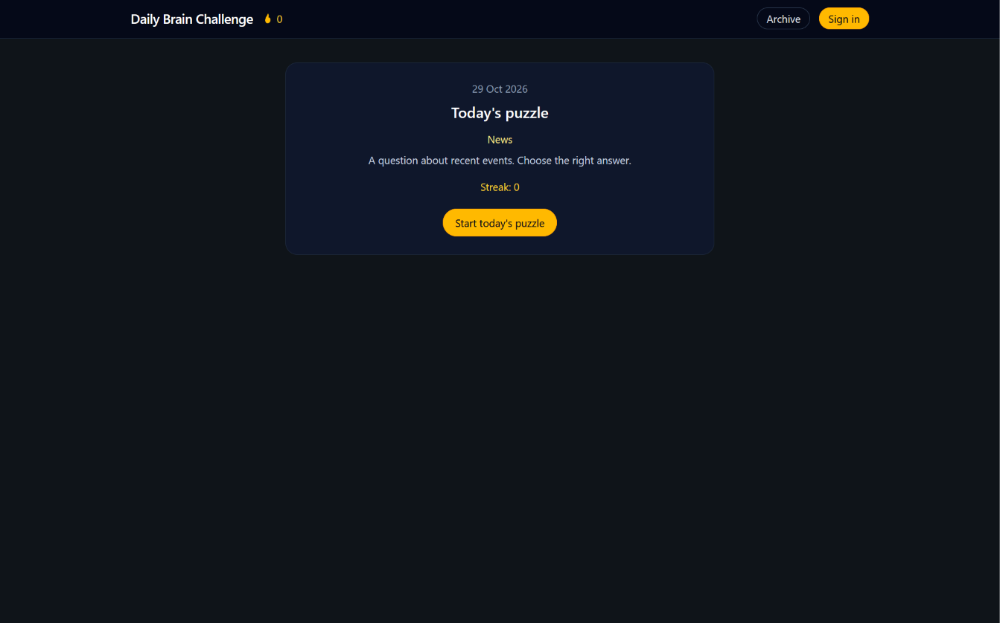
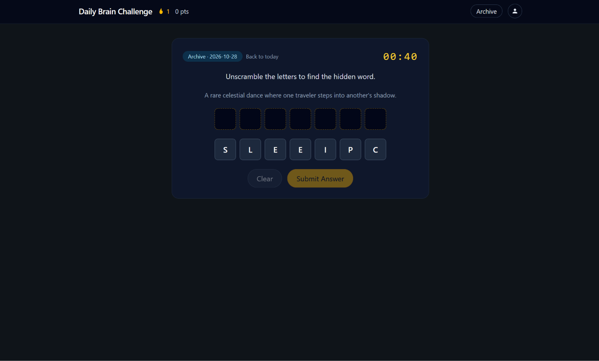
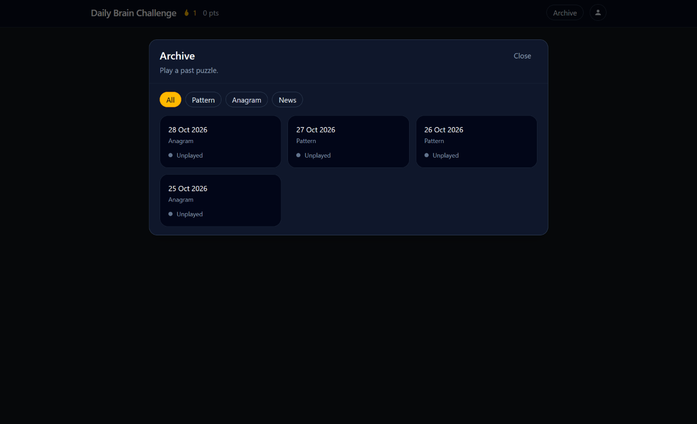
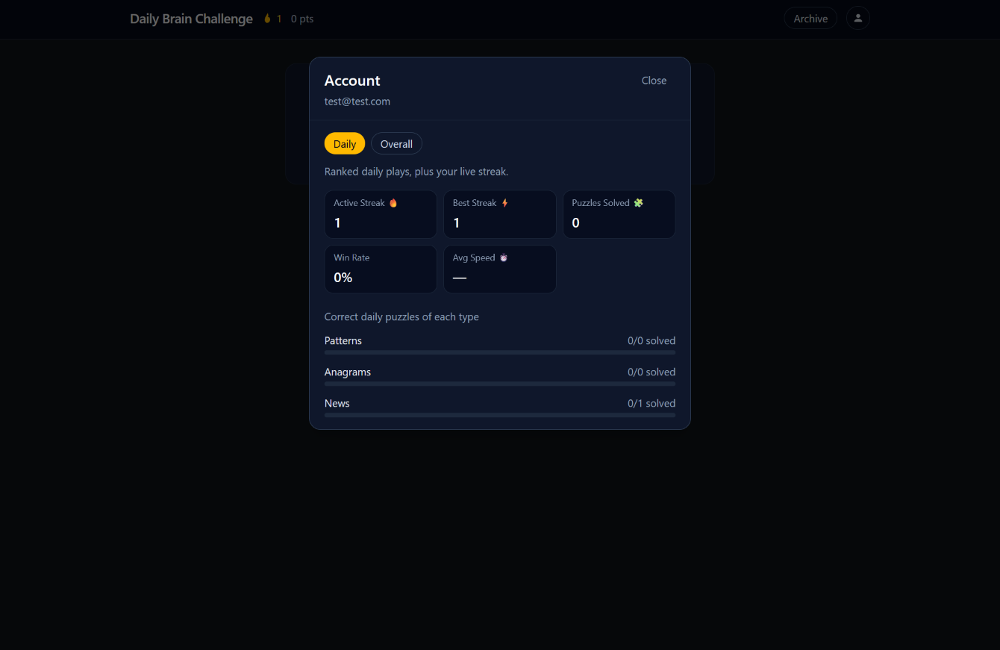
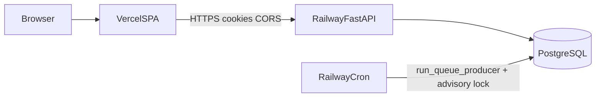
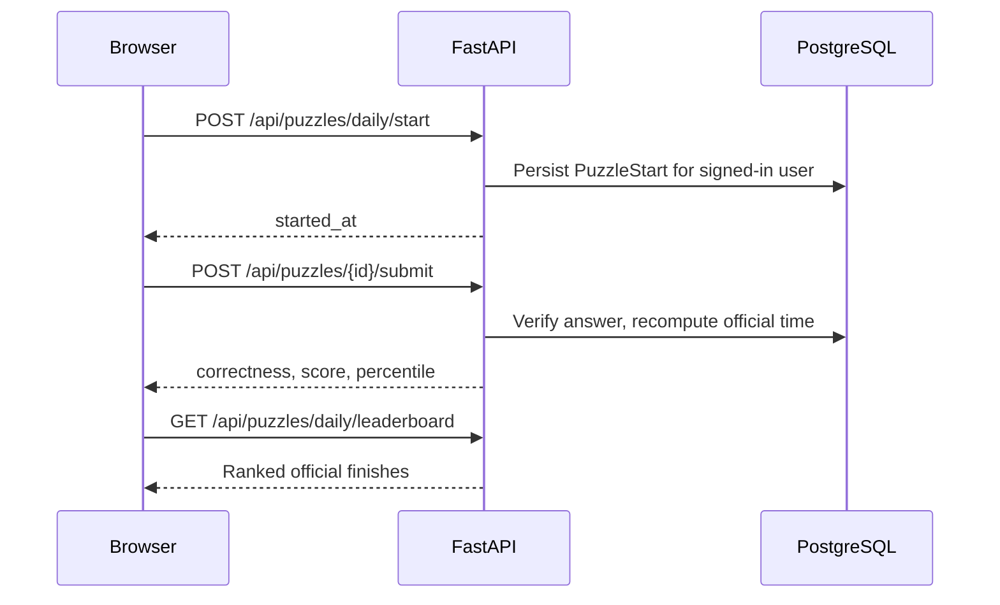
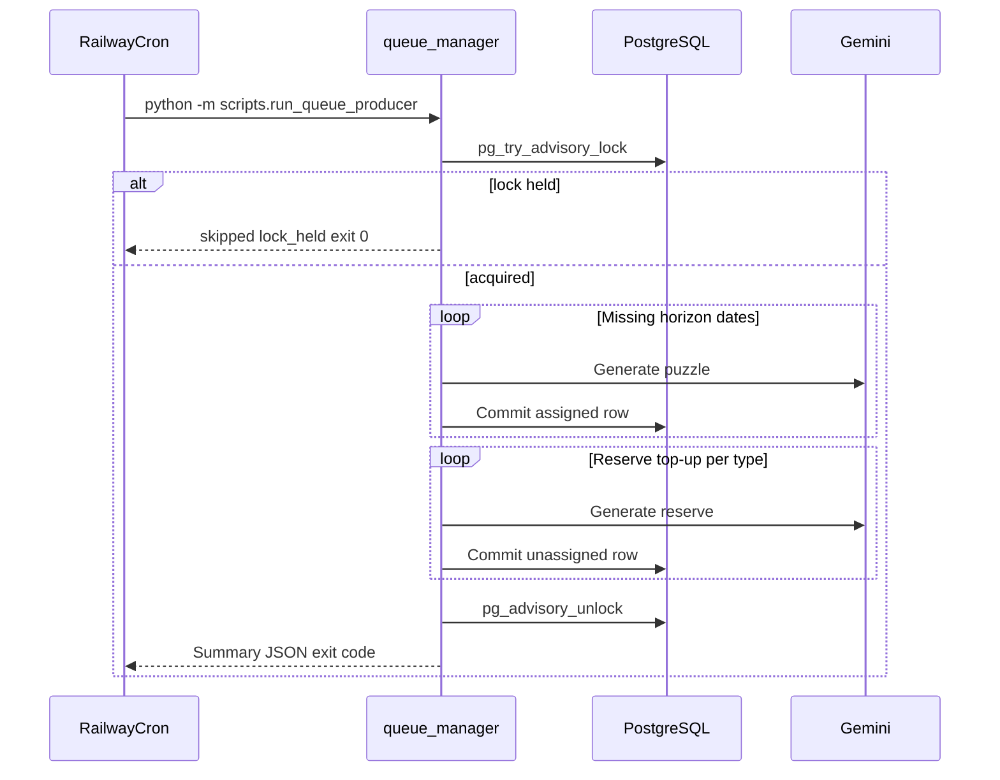

# Daily Brain Challenge

[](https://www.python.org/)
[](https://fastapi.tiangolo.com/)
[](https://react.dev/)
[](https://www.typescriptlang.org/)
[](https://www.postgresql.org/)
[](https://tailwindcss.com/)
[](https://vite.dev/)
[](https://railway.app/)
[](https://vercel.com/)

A full-stack competitive daily logic puzzle platform — AI-generated puzzles, ranked play, guest-to-account migration, and production deploy on Vercel + Railway.

**Live demo:** [https://the-daily-brain-challenge.vercel.app](https://the-daily-brain-challenge.vercel.app)
**API health:** [https://daily-brain-challenge.up.railway.app/health](https://daily-brain-challenge.up.railway.app/health)

<p align="center">
  
</p>

---

## Key features

### Custom logic puzzle engines

Three engines rotate on a fixed weekday schedule (Pattern Mon, Anagram Wed, News Fri; other days rotate):

| Engine | What players solve | Notable constraints |
| --- | --- | --- |
| **Pattern** | Grid / sequence logic | Generator subkinds: numerical, unicode, and shape (including 4×4 polygon grids and rotation math) |
| **Anagram** | Scrambled real English words | Solutions validated as **6–8** letter dictionary words against [`backend/app/data/anagram_words.txt`](backend/app/data/anagram_words.txt); common easy words rejected |
| **News** | Headline-grounded multiple choice | Generated with Gemini against current briefing material |

Answers are never returned from puzzle `GET` endpoints. Correctness is decided only on submit.

### Ranked daily play vs historical archive

- **Official daily:** signed-in players start a server-side clock (`POST /api/puzzles/daily/start`). On submit, the API recomputes elapsed time from `PuzzleStart` so client clocks cannot inflate rankings. Guests can still play for correctness with a local start timestamp.
- **Scoring:** 100 points within 10s, then −1/s, floor of 1 if correct.
- **Leaderboard:** anonymous daily rankings for official finishes (`GET /api/puzzles/daily/leaderboard`).
- **Archive:** authenticated practice on past puzzles with client-side timers and per-puzzle completion benchmarks (not a full historical leaderboard).

<p align="center">
  
  &nbsp;&nbsp;
  
</p>

### Dual-modal account UX

- **Account / stats:** daily vs overall scopes — streaks, win rate, average speed, and per-engine breakdowns (Patterns / Anagrams / News).
- **Settings:** display name, email change (current password required), Argon2 password change, theme preference, clear guest data, delete account.

<p align="center">
  
</p>

### Auth, cookies, and guest migration

- **httpOnly cookies** for access JWT (short-lived) and opaque refresh token (hashed at rest, rotated on refresh).
- **Argon2** password hashing via `pwdlib`.
- **Guest → account:** on register/login, the SPA migrates local completions and can adopt a guest streak when the account has none yet.
- Production cross-origin setup (Vercel page ↔ Railway API): `COOKIE_SECURE=true`, `COOKIE_SAMESITE=none`, and an exact `CORS_ORIGINS` whitelist, plus `TrustedOriginMiddleware` for cookie-bearing writes.

---

## System architecture



### Daily play sequence



### Queue replenishment sequence



---

## Production infrastructure and resilience

| Piece | Role |
| --- | --- |
| **Vercel** | Static Vite SPA; `VITE_API_BASE` baked at build time |
| **Railway web** | FastAPI + uvicorn on `$PORT`; pre-deploy `alembic upgrade head` |
| **Railway Postgres** | Source of truth for puzzles, users, completions, starts |
| **Railway cron** | Same image; schedule `10 0 * * *` UTC; start `python -m scripts.run_queue_producer` |

### Puzzle queue

- Maintains a **7-day** assigned horizon and **2** unassigned reserves per engine.
- Production **does not** replenish on API boot (avoids racing the cron). Development may replenish on startup when `GEMINI_API_KEY` is set.
- Replenishment takes a **session-level** Postgres advisory lock (`pg_try_advisory_lock`) so overlapping cron/manual runs cannot double-fill the same dates. The lock is held on a dedicated connection for the whole run because the worker commits per puzzle.
- The producer exits non-zero when `failures` is non-empty so a half-filled night shows up as a failed cron run.

### Cross-site cookie security

Intended production variables (see [`backend/.env.example`](backend/.env.example)):

```text
APP_ENV=production
COOKIE_SECURE=true
COOKIE_SAMESITE=none
CORS_ORIGINS=https://YOUR-VERCEL-URL.vercel.app
```

Railway’s `postgresql://` / `postgres://` `DATABASE_URL` is rewritten to `postgresql+asyncpg://` at settings load. Outside development, the process refuses the local JWT secret, localhost CORS, or `SameSite=None` without `Secure`.

---

## Local development

### Prerequisites

- Python 3.12+
- Node.js 20.19+ or 22.12+
- Docker (for local Postgres 16)

### Backend

```bash
cd backend
cp .env.example .env          # add GEMINI_API_KEY if you want generation
docker compose up -d          # Postgres on localhost:5432
python -m venv .venv
# Windows: .venv\Scripts\activate
# macOS/Linux: source .venv/bin/activate
pip install -r requirements.txt
alembic upgrade head
uvicorn app.main:app --reload --host 0.0.0.0 --port 8000
```

Optional queue fill (same logic as production cron):

```bash
python -m scripts.run_queue_producer
```

### Frontend

Leave `VITE_API_BASE` unset locally — Vite proxies `/api` to `http://127.0.0.1:8000`.

```bash
cd frontend
cp .env.example .env          # optional; only needed for production-style API URL
npm install
npm run dev
```

Open the Vite URL (typically `http://localhost:5173`).

---

## Testing

Backend tests expect Postgres from Compose and skip if the database is unreachable.

```bash
# from backend/ with venv active and docker compose up
pytest
```

```bash
# from frontend/
npm test
```

Coverage areas include verification and scoring, daily/archive submit, guest completion, streak adopt, queue replenishment and advisory lock behaviour, production settings guards, account/stats UI behaviour, and guest start-clock storage.

---

## Project layout

```text
.
├── backend/
│   ├── app/                 # FastAPI app, models, services, engines
│   ├── alembic/             # Schema migrations
│   ├── scripts/             # Queue producer, seeds, inventory checks
│   ├── tests/               # Pytest suite
│   ├── Dockerfile           # Multi-stage API / cron image
│   ├── railway.toml         # Web deploy hints (pre-deploy, healthcheck)
│   └── docker-compose.yml   # Local Postgres 16
├── frontend/
│   └── src/                 # React 19 + Vite SPA, boards, modals, tests
└── docs/
    └── assets/              # Screenshot drops for this README
```

---

## Roadmap

- More puzzle types being added to round out the week - e.g. '2 Facts, 1 Fiction', 'Word Chain', etc.
- Puzzle difficulty - Either by having a specific hard mode day each week or by offering a hard mode toggle for each day
- Transactional email (verify address / forgot-password) is not shipped; logged-in users can currently still change email and password with the current password.

## Known gaps

- Archive benchmarks are per-puzzle, not a global historical leaderboard.
- Cold queue fills are intentionally paced for Gemini free-tier RPM limits; nightly top-ups are much shorter once the horizon is warm.

---

## License

Portfolio project
